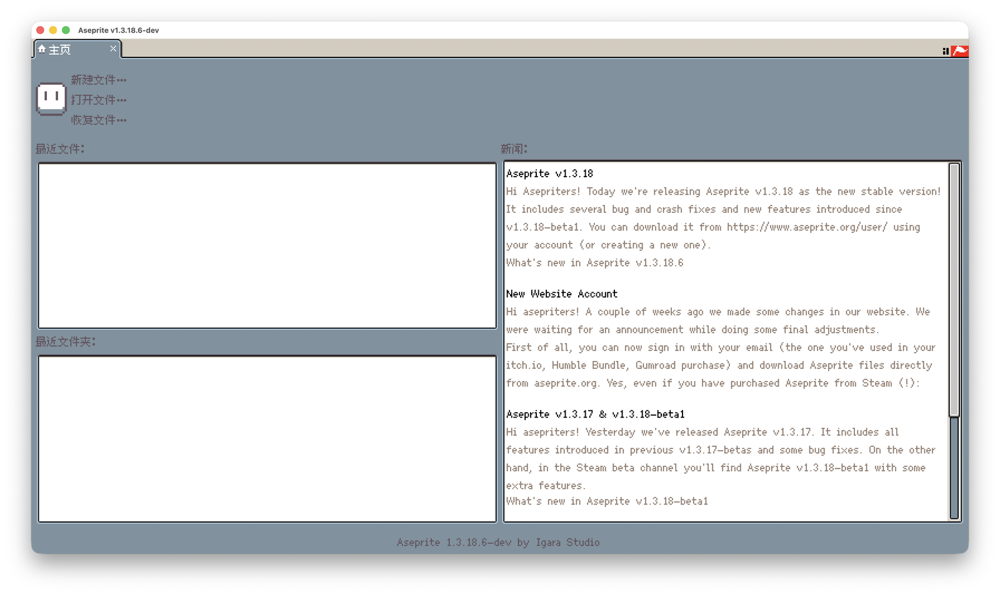
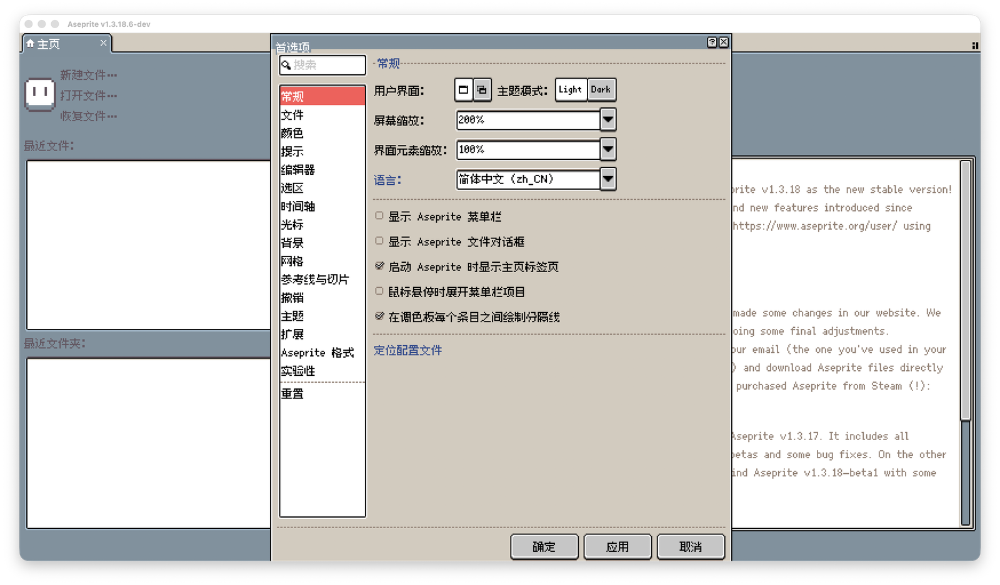
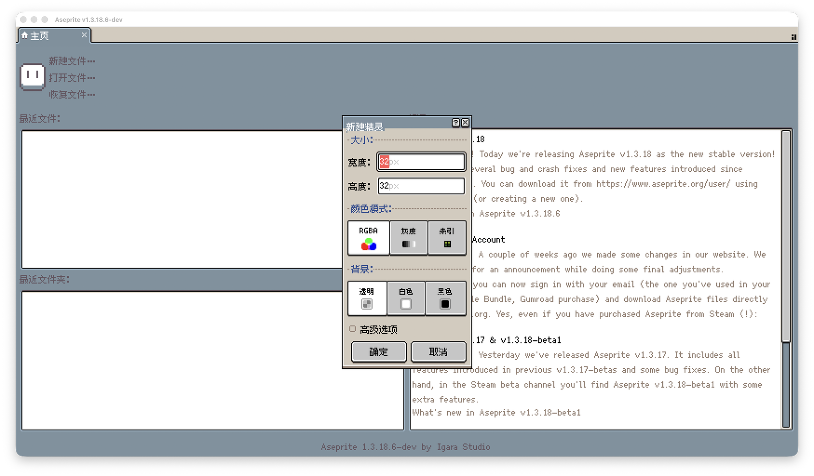

# Aseprite 简体中文汉化 · 干净整洁版

[](https://github.com/Shaoji-Lumine/aseprite-zh-clean/releases)
[](NOTICE.md)

> 一套**完全自建、干净整洁**的 Aseprite 简体中文汉化方案。
> 不用现成汉化包，不拼凑，不糊字：1834 条界面文本全量自译 + 中文像素字体，接近原版像素风的完整中文界面。





## 为什么是「干净整洁版」

- **全量自建翻译**：直接以官方 `data/strings/en.ini` 为源，111 个分节、1834 条字符串逐条翻译，不依赖任何第三方汉化包，也不会有奇怪的残留英文/繁体/机翻腔。
- **统一像素字体**：自带 Fusion Pixel 缝合像素字体（正文 10px / 迷你控件 8px），中英文同一像素风格，不模糊、不挤字、不裁切、不错位。
- **字形全覆盖**：汉化文本涉及的 732 个非 ASCII 字符全部有字形（0 缺字），不会出现“□”或豆腐块。
- **术语统一**：精灵 / 图层 / 单元格 / 帧 / 图块 / 选区 / 调色板 / 首选项 / 洋葱皮……按统一术语表翻译，避免前后不一致。
- **干净安装**：脚本自动备份原文件，一键还原；只改 Aseprite.app 内的资源文件，不往系统里塞东西。
- **可审计**：翻译源文件、安装脚本、字体授权全部开源，改动一目了然。

## 安装（macOS，需已有 Aseprite）

> 本仓库**不包含 Aseprite 本体或源码**。Aseprite 是 Igara Studio 的商业软件，请通过 [官网](https://aseprite.org/) / Steam / itch.io 合法获取。

0. 直接下载打包好的发布包：**[aseprite-zh-clean-v1.0.0.zip](https://github.com/Shaoji-Lumine/aseprite-zh-clean/releases/download/v1.0.0/aseprite-zh-clean-v1.0.0.zip)**（解压后用里面的脚本安装）。
1. 把 `Aseprite.app` 放进「应用程序」。
2. 下载本仓库（或 `git clone`），在仓库目录执行：

```bash
chmod +x scripts/install-macos.sh
./scripts/install-macos.sh "/Applications/Aseprite.app"
```

3. 完全退出并重新打开 Aseprite。若界面仍是英文：**编辑 → 首选项 → 常规 → 语言 → 简体中文**。

卸载/还原原版：

```bash
./scripts/uninstall-macos.sh "/Applications/Aseprite.app"
```

## 从源码构建（想要 100% 完整汉化，含 macOS 原生菜单）

官方源码编译版可以一并汉化 `关于/设置/隐藏/退出/最小化/缩放/窗口` 这些 macOS 原生菜单项。

```bash
# 1. 获取 Aseprite 源码（官方 release 的 Source.zip 或 git clone --recursive）
# 2. 应用汉化
python3 scripts/apply-to-source.py /path/to/aseprite

# 3. 按官方 INSTALL.md 编译，例如 macOS：
export SKIA_DIR=~/deps/skia   # 从 https://github.com/aseprite/skia/releases 下载
cmake -B build -S /path/to/aseprite -G Ninja -DCMAKE_BUILD_TYPE=Release \
      -DLAF_BACKEND=skia -DSKIA_DIR="$SKIA_DIR" \
      -DSKIA_LIBRARY_DIR="$SKIA_DIR/out/Release-arm64"
cmake --build build --target aseprite -j 8
```

## 仓库内容

```
i18n/zh_CN.ini                 # 全量简体中文语言文件（111 节 / 1834 条）
i18n/en.ini                    # 官方英文原文（CC BY 4.0，便于对照）
tools/validate.py              # 键 / 占位符 / 转义一致性校验（本地运行）
fonts/FusionPixel-*.ttf        # Fusion Pixel 像素字体（OFL 1.1）
fonts/OFL.txt, fonts/LICENSES/ # 字体授权
scripts/install-macos.sh       # 一键注入已有 Aseprite.app
scripts/uninstall-macos.sh     # 还原原版
scripts/apply-to-source.py     # 应用到源码（含 macOS 原生菜单汉化）
screenshots/                   # 界面截图
```

## 已知说明

- 首页“新闻”栏是 Aseprite 官方联网获取的英文公告，属于外部内容，不在汉化范围内。
- 安装到**已签名的官方 app** 上时，脚本会 ad-hoc 重新签名；这是 macOS 本地修改资源的常规做法。
- 字体放大到 10px 是为了中文可读性；整体像素风与 Aseprite 原界面一致。

## 许可与致谢

- 汉化文本（`i18n/zh_CN.ini`）：基于 Aseprite 官方 `en.ini`（CC BY 4.0）翻译，按 **CC BY 4.0** 发布。
- 脚本代码：**MIT**。
- 字体：[Fusion Pixel Font](https://github.com/TakWolf/fusion-pixel-font)（TakWolf），**SIL Open Font License 1.1**，授权文件见 `fonts/`。
- Aseprite © Igara Studio S.A. / David Capello。本项目为非官方汉化项目，与 Igara Studio 无关联；请遵守 Aseprite EULA，勿分发软件本体。

详见 [NOTICE.md](NOTICE.md)。

---

## English summary

A clean, from-scratch **Simplified Chinese localization** for Aseprite.

- **Fully self-made**: all 1,834 UI strings (111 sections) translated from the official
  `en.ini`, without using any third-party Chinese patch.
- **Unified pixel font**: bundles Fusion Pixel 10px/8px so Chinese and Latin text share
  the same crisp pixel look — no blur, no clipping, no misalignment.
- **Complete glyph coverage**: all 732 non-ASCII characters used by the translation
  have glyphs (zero tofu boxes).
- **Clean install**: the script backs up the original resources and can restore them
  with one command; no system files are touched.
- **No Aseprite binary included** (EULA): bring your own legally obtained copy, then
  run `scripts/install-macos.sh` or `scripts/apply-to-source.py`.

License: translation CC BY 4.0 · scripts MIT · fonts OFL 1.1.
